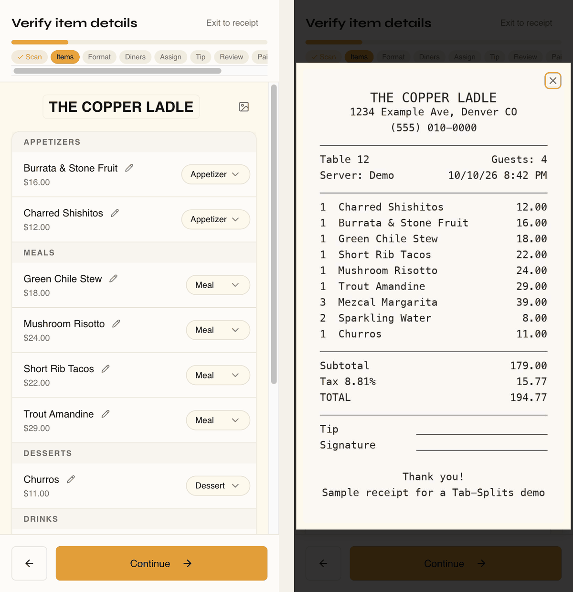
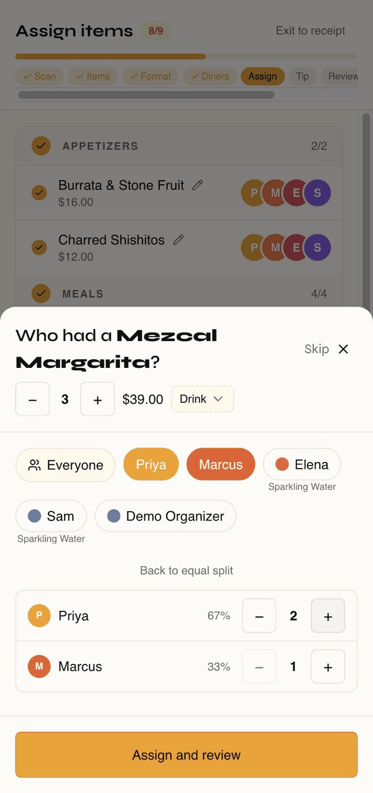

# Tab-Splits

**Live app: [www.tabsplits.com](https://www.tabsplits.com)**

Tab-Splits turns a restaurant receipt into a fair, itemized tab for everyone at the table. Scan the receipt, check what the AI read, assign or share each item, and send every diner a link showing what they owe, with tax and tip included.

I built it for **Amuse-Bouche**, a Denver food collective I organize. I bring small groups together over restaurant meals, often people who've never met, with different budgets and different orders. Settling up used to be the most awkward part of a lovely evening. "Let's just split it evenly" quietly penalizes the person who ordered soup and water, and doing the math properly on a phone at the table is slow and error-prone. Tab-Splits exists so the bill doesn't undermine the friendships the dinner was meant to start.

I independently direct the product, UX, technical decisions, testing, and iteration, using AI-assisted development tools to write most of the implementation (more in [How I built it](#how-i-built-it)).

---

## The experience

A guided flow takes the organizer from photo to shared tab:

1. **Scan.** Snap the receipt. GPT-4o vision extracts the restaurant, line items, subtotal, tax, and any auto-gratuity.
2. **Verify.** Review and correct what the AI read, next to the original photo. Items are auto-categorized (appetizer, meal, drink, dessert).
3. **Choose the meal format.** *Family Style* pre-assigns shared food to everyone. *Coursed* pre-assigns appetizers and desserts and leaves mains and drinks individual. *Mixed Bag* starts from scratch.
4. **Assign.** Step through items one at a time: who had it? Items split equally, or *by share* when people had different amounts.
5. **Tip, review, and who paid.** Set the tip and check each diner's itemized total before anything is sent.
6. **Share.** One read-only link, by QR code or text message. Diners pick their name (no login) and land on their own tab: their items, their share of tax and tip, and a button that opens Venmo with the amount filled in.

<!-- SCREENSHOTS: see docs/screenshots/README.md. Once captured, insert here in flow order:




-->

## Real-world use

I've used Tab-Splits at Amuse-Bouche dinners since January 2026. Figures from my organizer account in the production database, as of October 2026:

| | |
|---|---|
| Bills split | **10** group bills, on 9 different dates (January–September 2026) |
| Restaurant spend covered | **$4,017** in receipt totals. The app calculates shares; it doesn't process payments |
| Diners | **17** distinct people across **45** diner-seats, 3–6 per bill |
| Repeat participation | 9 of the 17 joined two or more split bills |
| Other accounts | 5 other people registered; 2 of them have assigned a group bill of their own |

### How it changed with use

The commit history shows the product changing shape as it got used:

- **From an editing screen to a guided flow.** Early versions were a single receipt screen. In April 2026 it became a step-by-step wizard, refined through May, so organizing a tab at the table means answering one question at a time.
- **Meal formats.** *Family Style*, *Coursed*, and *Mixed Bag* presets do most of the assigning for typical group dinners, leaving only the genuinely individual items.
- **Split by share.** Not every shared item is shared evenly, so items can be weighted per person.
- **A review step before sharing.** The organizer checks each diner's total before anyone else sees it.
- **Sharing built for a dinner table.** QR codes, per-person text messages, a name picker instead of logins, and Venmo deep links.
- **Receipt quirks.** Auto-gratuity and service charges go into the tip rather than being treated as a dish, and duplicate lines (`2x Lychee Martini` + `1x Lychee Martini`) are merged.

## Product and technical decisions

**1. AI does the reading; the organizer makes the call.** Vision models misread receipts: a missed line, a unit price taken as a line total, gratuity hidden in the subtotal. So extraction is treated as a draft that the organizer checks against the photo. When the items don't add up to the receipt subtotal, the app says by how much and explains that individual shares won't sum to the bill. It offers optional fixes but **never blocks sharing**, because the organizer at the table knows things the receipt doesn't (a comped dish, a side deal). Diners see a matching note on their link, so a mismatch is never silent.

**2. One calculation everywhere, accurate to the cent.** The organizer's view, the review step, and each diner's link all use the same function, so everyone sees the same numbers. Tax and tip are split in proportion to what each person ordered, and amounts are allocated in whole cents. Before that change, roughly 3 in 10 randomized test bills had per-person amounts that missed the receipt total by a cent or so. Now, when every item is assigned and the items match the subtotal, the shares sum exactly to the bill, and a randomized test enforces it.

**3. Diners get a link, not an account.** Asking guests to sign up to see a $38 tab would recreate the friction the app exists to remove. The tradeoff: the link is the key. Anyone who has it can view that tab, and diners choose their own name rather than being verified. So the link reveals as little as possible: names as the organizer entered them, never phone numbers or emails. The receipt photo is served only to the organizer or to holders of that receipt's link. Links stay stable, so one already texted to the table keeps working after edits.

**4. Engineering effort goes where money, privacy, and reliability are at stake, not into speculative infrastructure.** Re-scanning or deleting a receipt happens in a single database transaction, so a dropped connection can't leave a half-empty bill. Request logs exclude response bodies, and production won't start without a real session secret. Just as deliberate is what's *not* here: no indexes for scale it doesn't have, no error-tracking vendor, no major dependency upgrades for advisories that don't apply to how it runs. [`BACKLOG.md`](BACKLOG.md) records those deferrals and why.

## How I built it

I started Tab-Splits in November 2025 on Replit, using Replit's AI agent and its hosted database, storage, and AI and email connectors. That was the fastest way to learn whether the idea worked at a real dinner.

In July 2026 I moved it, working with Claude Code, onto services I control: code on **GitHub**, Postgres and file storage on **Supabase** (migrated with `pg_dump`, with existing receipt images kept working), and hosting on **Vercel**. Three motivations drove that move:

1. **Solve a real problem for my community**, reliably enough that people can trust the numbers.
2. **Own the stack**: understand, maintain, and deploy it outside any single platform.
3. **Build transferable fluency** with real development and deployment workflows, beyond AI-assisted prototyping: version control and reviewable commits, environment and secrets management, database migration, deployment, debugging, and automated testing.

My role is product owner, designer, and technical lead, working through AI-assisted coding tools. I:

- defined the problem and requirements from what I saw at real dinners;
- designed the flows and interaction details (the wizard, meal formats, split-by-share, the diner-facing link);
- made the product and technical calls (the pricing rule, what gets validated where, what to secure and what to defer), working through options and tradeoffs with the AI tools;
- reviewed, tested, and debugged the output, including catching several rounds of split-math errors;
- set the quality bar: one shared calculation instead of copies, and focused automated tests for the parts that handle money and private data.

AI tools wrote most of the implementation code under that direction.

---

## Architecture

| Layer | Technology |
|---|---|
| Frontend | React 18 + Vite, wouter, TanStack Query, Tailwind + shadcn/ui |
| API | Express (TypeScript), session auth via `express-session` + `connect-pg-simple` |
| Database | Supabase Postgres via Drizzle ORM (`drizzle-orm/node-postgres` over the transaction pooler) |
| File storage | Supabase Storage (private `receipts` bucket, signed upload/download URLs) |
| AI | OpenAI `gpt-4o` for receipt extraction and item categorization |
| Email | Resend (password reset) |
| Hosting | Vercel: static client from `dist/public`, the Express app as a Fluid Compute function |

### How it's wired

- `shared/schema.ts`: Drizzle table definitions and zod validation schemas, shared by client and server.
- `shared/splitMath.ts`: all bill-splitting math (item shares, per-person totals with cent allocation, and the subtotal check behind the discrepancy warnings).
- `server/app.ts`: builds the Express app (sessions, request logging, routes) without listening; used by both entries below.
- `server/index.ts`: local entry. Dev mode serves the client through Vite with HMR; `npm start` serves the built client.
- `api/index.mjs`: Vercel entry. `build:vercel` bundles `server/app.ts` into `api/_app.mjs` (generated, git-ignored).
- `vercel.json`: `/api/*` and `/objects/*` rewrite to the function; everything else falls back to the SPA.
- `server/receiptWrites.ts`: transactional multi-table writes (atomic re-scan, receipt deletion).
- `server/objectStorage.ts` + `server/objectAccess.ts`: receipt images. Clients request `POST /api/uploads/request-url`, PUT the file straight to Supabase, and store `/objects/uploads/<userId>/<uuid>`. `GET /objects/*` checks ownership or a matching `?share=<token>` before redirecting to a short-lived signed URL. Older `/objects/uploads/<uuid>` paths are authorized through the receipt that references them.

### Environment variables

See `.env.example`. All are server-side except `VITE_POSTHOG_KEY`.

| Variable | Purpose |
|---|---|
| `DATABASE_URL` | Supabase Postgres **transaction pooler** URI (port 6543). URL-encode special characters in the password. |
| `SUPABASE_URL` | `https://<project-ref>.supabase.co` |
| `SUPABASE_SERVICE_ROLE_KEY` | Secret key; used server-side for Storage signed URLs |
| `OPENAI_API_KEY` | Receipt extraction and item categorization |
| `RESEND_API_KEY` / `RESEND_FROM_EMAIL` | Password-reset emails |
| `SESSION_SECRET` | Session cookie signing (`openssl rand -hex 32`). **Required** in production and on Vercel; the server refuses to start without it. |
| `VITE_POSTHOG_KEY` | Optional client analytics |

Secrets are never committed: `.env` is git-ignored, and deployed values live in Vercel project env vars.

### Local setup

```sh
npm install
cp .env.example .env   # fill in DEVELOPMENT values (see docs/environments.md), never production
npm run dev            # Express + Vite HMR on http://localhost:5000
```

| Script | |
|---|---|
| `npm test` | Focused test suite (split math, image access rules, transactional writes against in-memory Postgres via PGlite). Needs no env vars or network. |
| `npm run check` | Typecheck |
| `npm run build` / `npm start` | Production build and server, locally |
| `npm run db:push` | Push schema changes with drizzle-kit (creates all tables on a fresh database; the `session` table is created on first run) |

### Deployment

Production runs on Vercel (Fluid Compute) at [www.tabsplits.com](https://www.tabsplits.com). Vercel's GitHub integration deploys `main` to production; other branches get Preview deployments. Keep Preview on a development database. See [`docs/environments.md`](docs/environments.md).

## Scope and limitations

Tab-Splits is an independent product built for a real community, not a commercial SaaS platform, and it's sized accordingly.

- **It calculates; it doesn't move money.** Payment happens in Venmo via a prefilled deep link. The app records who paid the restaurant, not who has paid back.
- **Share links are bearer links.** Anyone with the link can view that tab, by design, so diners don't need accounts. Diners pick their own name and aren't individually authenticated. Links don't expire.
- **AI extraction needs a human check.** The flow builds one in, and flags bills whose items don't match the subtotal, but the organizer makes the final call.
- **Built for dinner-party scale.** Tables of a handful of people and a few bills a month, on hobby-tier infrastructure.
